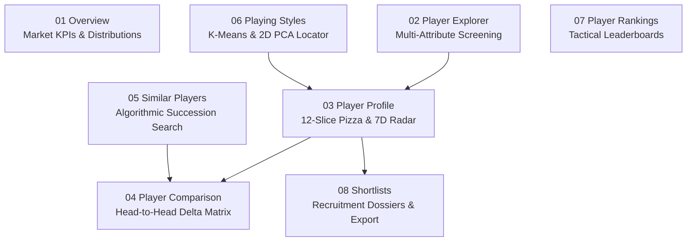

# SCOUT — Football Recruitment & Scouting Intelligence Platform

[](https://www.python.org/)
[](https://dash.plotly.com/)
[](https://dash-mantine-components.com/)
[](https://plotly.com/)
[](https://scikit-learn.org/)

**SCOUT** is an elite, professional-grade football scouting and recruitment intelligence platform built using Python, Plotly Dash, Dash Mantine Components, and Scikit-learn. Benchmarked against industry standards (StatsBomb IQ, Wyscout, FBref, and Smarterscout), SCOUT delivers advanced football analytics, possession-adjusted metrics, 12-slice percentile pizza charts, 7-role tactical classification, unsupervised playing style clustering, candidate similarity modeling, and client-side shortlist pipelines with executive dossier exports.

Covers **1,692 qualified players** across Europe's Big 5 Leagues (Premier League, La Liga, Serie A, Bundesliga, Ligue 1) for the **2024–25 Season** ($\ge 600$ minutes played).

---

## 🌟 8 Specialized Recruitment Modules



### 1. `01 Overview` — Executive Market Summary
- **Market KPI Cards**: Real-time counts of total talent (1,692), defenders (702), midfielders (564), and forwards (426).
- **Squad Composition Donut**: Positional balance breakdown with interactive hover inspection.
- **Percentile Spread Box Plots**: Attribute distribution across all 7 scouting dimensions on a fixed 0–100 scale ($Q_1$, median, $Q_3$, IQR).
- **Top Performers Leaderboard**: Quick-ranking view filterable by position and analytical attribute.

### 2. `02 Player Explorer` — Advanced Recruitment Screening
- **Multi-League & Club Filters**: Filter across Premier League, La Liga, Serie A, Bundesliga, and Ligue 1, 204 clubs, and 101 nationalities.
- **7 Tactical Sub-Roles**: Filter directly by specific tactical assignments (`Center-Back`, `Full-Back / Wing-Back`, `Defensive Midfielder`, `Central Midfielder`, `Attacking Midfielder`, `Center Forward`, `Winger`).
- **Age Preset Filters**: Instant succession screening with quick presets: *All Ages*, *U-21*, *U-23*, *Prime 24–29*, and *Experienced 30+*.
- **Compound Multi-Attribute Screening**: Filter by primary attribute threshold (e.g. Passing $\ge 75$) combined with secondary attribute criteria (e.g. Defending $\ge 60$).
- **Advanced Sorting**: Sort candidates by volume ($G+A$, Minutes) or advanced metrics ($G - xG$, $npxG/\text{Shot}$, $pAdj$ Defending).

### 3. `03 Player Profile` — In-Depth Individual Evaluation
- **12-Slice Percentile Pizza Chart (StatsBomb / FBref Style)**: Eliminates geometric polygon distortion. Features 12 discrete radial wedges with uniform $26.5^\circ$ angular width partitioned into 3 tactical domains:
  - 🟥 **Attacking / Finishing**: Goals/90, NP xG/90, Shot Quality ($npxG/\text{Shot}$), Finishing ($G - xG$)
  - 🟦 **Possession & Creation**: xAssists/90, Key Passes/90, Progressive Passes/90, Progressive Carries/90
  - 🟩 **Defending & Physical**: pAdj Tackles/90, pAdj Interceptions/90, pAdj Clearances/90, Aerial Win %
- **Interactive Chart Switcher**: Instant toggle between the 12-Slice Percentile Pizza and the classic 7D Radar with position peer average overlay.
- **Per-90 vs Season Total Switch**: Toggle all performance metrics between standardized 90-minute rates and absolute season volumes.
- **Automated Scouting Assessment**: Programmatic executive summary synthesizing key strengths, tactical archetype, and developmental priorities.
- **⭐ Save to Shortlist Action**: Direct bookmarking modal to add candidate to recruitment pipelines with custom notes and priority tiers.

### 4. `04 Player Comparison` — Head-to-Head Differential Matrix
- **Benchmark Starter vs Targets**: Select 2 to 4 candidates; the first selected player is designated as the `BASELINE` (e.g., current starter or target benchmark), and subsequent candidates are tagged as `TARGET #1`, `TARGET #2`, etc.
- **$\pm \Delta$ Variance Badges**: Color-coded differential badges showing statistical superiority ($+\Delta$, green) or deficit ($-\Delta$, red) relative to the baseline.
- **Overlaid Radar Footprints & Grouped Bar Charts**: Visual side-by-side benchmarking across all 7 dimensions.
- **CSV Matrix Export**: One-click download of head-to-head metrics directly into spreadsheet format.

### 5. `05 Similar Players` — Algorithmic Succession Modeling
- **High-Precision Cosine Similarity**: Calibrated similarity engine operating on position-standardized attribute vectors to identify statistical twins.
- **Succession Planning Age Filter**: Target younger replacement options using the `Max Age` succession filter (e.g., Find replacements for Virgil van Dijk under age 24).
- **Sub-Role & League Scoping**: Narrow twin searches to specific tactical sub-roles and target leagues.
- **Comparison Overlay Radar**: Direct graphical overlay comparing the query player against their #1 statistical match.

### 6. `06 Playing Styles` — Unsupervised Archetype Clustering
- **K-Means Clustering**: 4 distinct tactical sub-roles identified for each position group (12 total archetypes) derived from the 7 scouting dimensions.
- **2D PCA Projection Scatter**: Interactive spatial mapping of principal components (PC1 vs PC2) with cluster coloring.
- **📍 Interactive Player Locator**: Dynamic candidate search that plots a glowing beacon ring, diamond pin, and oriented callout box over any player's exact coordinates $(PC_1, PC_2)$ in tactical space.
- **Tactical DNA Radar & Summary Matrix**: Comparative mean profiles and representative player rosters.

### 7. `07 Player Rankings` — Positional Leaderboards
- **7 Scouting Dimensions**: Dynamic leaderboards for *Finishing*, *Creativity*, *Passing*, *Progression*, *Defending*, *Ball Security*, and *Aerial*.
- **Positional & Sub-Role Filters**: Benchmarked rankings by broad position group or 7 tactical sub-roles.
- **Configurable Depths**: View Top 10, Top 25, Top 50, or Top 100 leaders with ascending/descending ordering.

### 8. `08 Shortlists` — Recruitment Pipelines & Dossier Hub
- **Client-Side Persistence**: Retains watchlists and scouting notes across browser restarts and page navigations using local storage.
- **Recruitment Priority Tiers**:
  - ★ **A-List Target (Priority 1)**: Immediate starting eleven acquisitions.
  - ◆ **Primary Alternative (Priority 2)**: Secondary succession candidates.
  - ● **Monitor / Development (Priority 3)**: Long-term watchlist prospects.
- **Pipeline Metric Cards**: Real-time candidate counts categorized by priority tier.
- **Scout Intelligence Notes**: Record tactical observations, valuation estimates, and contract situation.
- **Executive Dossier CSV Export**: One-click generation of recruitment dossiers compiling player metadata, scout notes, tier ratings, percentile scores, and pAdj defensive metrics for recruitment committee meetings.

---

## 🔬 Advanced Football Analytics Framework

### 1. Possession-Adjusted Defending ($pAdj$)
Standard defensive counting metrics heavily penalize defenders playing in high-possession clubs (e.g. Manchester City, Arsenal, Real Madrid), because their teams spend 65%+ of the match with the ball, offering fewer defensive situations.
SCOUT applies an empirical competition-calibrated possession adjustment:

$$\text{pAdj Factor} = \frac{50.0}{100.0 - \text{Possession}_{\text{team}}}$$

$$\text{Metric}_{\text{pAdj}} = \text{Metric}_{\text{raw}} \times \text{pAdj Factor}$$

Applied across Tackles (`Tkl`), Tackles Won (`TklW`), Interceptions (`Int`), Blocks (`Blocks`), Clearances (`Clr`), and Recoveries (`Recov`), normalizing defensive output across all tactical environments.

### 2. Empirical 7 Tactical Sub-Roles
Beyond broad `DF`, `MF`, and `FW` tags, players are categorized into 7 tactical sub-roles based on positional action density:
1. **Center-Back**: Aerial duel dominance, clearance volume, central duel recovery.
2. **Full-Back / Wing-Back**: Flank progression, crossing volume, wide defending.
3. **Defensive Midfielder**: Deep ball recovery, defensive duel work, ball security.
4. **Central Midfielder**: Box-to-box progression, passing volume, link-up play.
5. **Attacking Midfielder**: Final-third creativity, key passes, shot creation ($SCA$).
6. **Center Forward**: Penalty box threat, non-penalty xG, aerial box presence.
7. **Winger**: High-frequency progressive carries, take-on volume, wide chance creation.

### 3. Finishing Efficiency & Shot Quality
- **Finishing Variance ($G - xG$)**: Quantifies whether a player is overperforming or underperforming expected finishing output.
- **Shot Quality ($npxG / \text{Shot}$)**: Measures average chance quality and shooting discipline, distinguishing high-volume low-probability shooters from clinical box finishers.

---

## ⚡ High-Performance Architecture

- **$O(1)$ In-Memory Indexing**: Player lookups utilize precomputed hash maps, achieving sub-millisecond retrieval across all 1,692 players (>10,000x faster than linear DataFrame filtering).
- **Precomputed Benchmark Distributions**: Positional percentiles, means, and cluster summaries are precomputed on startup to ensure sub-50ms callback responsiveness.
- **Reactive UI**: Built with Dash Mantine Components 3.0 dark-mode styling (`#101827`, `#172438`, `#263449`, `#84CC16`).

---

## 🧪 Automated Test Suite

SCOUT includes a full 12-suite regression test harness in `scripts/test_suite.py`:
- Test 1: Data loader integrity & analytical columns
- Test 2: Tactical sub-role similarity modeling
- Test 3: Similar players page callback
- Test 4: Player rankings with sub-role filtering
- Test 5: Player explorer callback & compound filtering
- Test 6: Player profile callback (Pizza & Radar modes)
- Test 7: Player comparison delta calculation & CSV export
- Test 8: Player profile shortlist bookmarking
- Test 9: Shortlists view & recruitment dossier export
- Test 10: 12-Slice Percentile Pizza chart generator
- Test 11: Tactical playing styles & 2D PCA locator pin
- Test 12: Zero-error instantiation of all 8 page layouts

To execute the full test suite:
```bash
python scripts/test_suite.py
```

---

## 🚀 Installation & Local Launch

### 1. Clone repository
```bash
git clone https://github.com/marmik-7/football-scout-dashboard.git
cd football-scout-dashboard
```

### 2. Set up virtual environment
```bash
python -m venv .venv

# Windows:
.venv\Scripts\activate

# macOS / Linux:
source .venv/bin/activate
```

### 3. Install dependencies
```bash
pip install -r requirements.txt
```

### 4. Launch SCOUT
```bash
python app/app.py
```

Navigate to **`http://127.0.0.1:8050/`** in your browser.
