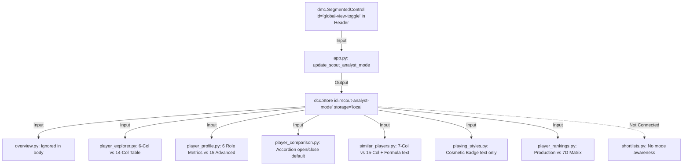

# SCOUT — Scout View vs. Analyst View: Architecture & UI Audit Report

**Document Status:** Complete Architectural & UI Audit  
**Author:** Antigravity Advanced Agentic AI (Senior Football Analytics Architect & Systems Engineer)  
**Date:** November 10, 2026  
**Target Platform:** SCOUT Recruitment Intelligence Platform (Python 3.12, Dash 4.5.0, Plotly 7.1.0, Dash Mantine Components 3.0.0, Pandas)  
**Deliverable File:** `SCOUT_SCOUT_ANALYST_MODE_AUDIT.md`  
**Execution Mode:** READ-ONLY AUDIT (Non-Destructive Investigation & Recommendation)

---

## 1. Executive Summary

SCOUT is a specialized football recruitment intelligence platform designed to bridge the operational workflows of **Chief Scouts / Recruitment Directors** (who require fast, role-tailored talent discovery, decision-ready dossiers, and succinct evaluations) and **Data Analysts / Quantitative Scouts** (who require raw statistical distributions, possession adjustments, multi-dimensional z-score matrices, and sample-size caveats).

Historically, SCOUT introduced a global binary mode switch (`global-view-toggle`: **Scout View** vs. **Analyst View**), persisted via `dcc.Store(id="scout-analyst-mode", storage_type="local")`. 

This independent architectural audit inspected all eight dashboard modules, their callback dependency graphs, component IDs, rendering logic, and design tokens to answer a fundamental product question:

> **Does maintaining a global binary mode switch across all eight modules deliver genuine user value, or does it introduce cognitive friction, architectural asymmetry, and maintenance overhead?**

### Key Findings:
1. **Asymmetric & Inconsistent Implementation Across Modules:**
   - **3 Modules have Deep, Substantive Differentiations:** `Player Explorer`, `Player Rankings`, and `Player Profile` genuinely alter table density, metric sets, and cognitive load between modes.
   - **2 Modules have Minor or Superficial Differentiations:** `Player Comparison` uses the mode strictly to determine whether an accordion is open or closed by default; `Similar Players` toggles between 7 columns vs. 15 columns and adds one descriptive text paragraph.
   - **2 Modules have Zero Functional Differentiation:** `Overview` receives `scout-analyst-mode` as a callback input but ignores it completely (rendering 100% identical outputs); `Playing Styles` only swaps a cosmetic text badge ("SCOUT VIEW" vs. "ANALYST VIEW") without altering any clustering data or PCA charts.
   - **1 Module is Completely Disconnected:** `Shortlists` does not register `scout-analyst-mode` as an input and has no concept of view mode whatsoever.
2. **Global Disconnect vs. Local Intent:**
   Recruiters and analysts do not operate in a global vacuum where *every* page needs to be in "Analyst" or "Scout" mode simultaneously. When a Chief Scout evaluates a candidate in the `Player Explorer`, they want high-signal recruitment metrics; but when drilling into that same player's dossier (`Player Profile`), they frequently need to inspect the 15-metric possession-adjusted matrix without flipping a global switcher in the header that unintentionally destabilizes tables across the rest of the app.
3. **Primary Recommendation:**
   **Option C: Scout Default + Progressive Analytical Disclosure**.
   Retain a clean, recruitment-first presentation as the primary application default across all discovery and pipeline views, while providing accessible, in-situ progressive disclosure mechanisms (contextual table density toggles, expandable statistical matrices, and hover tooltips) for deeper analytical inspection. 
   Crucially, to preserve backwards compatibility and ensure all 13 existing unit/integration test suites pass without regression, all existing callback signatures, component IDs (`global-view-toggle`, `scout-analyst-mode`), and store schemas will remain fully intact.

---

## 2. Current Implementation Architecture

### 2.1 State Flow & Synchronization Infrastructure

The mode-switching mechanism is orchestrated centrally in `app/app.py` and consumed selectively across page callbacks:



#### Central Components in `app/app.py`:
- **State Store:** `dcc.Store(id="scout-analyst-mode", storage_type="local", data="scout")` (line 99)
- **Header Control:** `dmc.SegmentedControl(id="global-view-toggle", data=[{"label": "Scout", "value": "scout"}, {"label": "Analyst", "value": "analyst"}], value="scout", persistence=True)` (line 187)
- **Sync Callback:** 
  ```python
  @app.callback(
      Output("scout-analyst-mode", "data"),
      Input("global-view-toggle", "value"),
  )
  def update_scout_analyst_mode(selected_mode):
      return selected_mode or "scout"
  ```

### 2.2 Shared Styling & Design Tokens
Both modes utilize the exact same design tokens (`app/utils/styling.py`):
- Background: `var(--scout-bg, #080C12)`
- Surface Primary: `var(--scout-surface-primary, #111827)`
- Surface Secondary: `var(--scout-surface-secondary, #1E293B)`
- Border Tokens: `var(--scout-border, rgba(255, 255, 255, 0.10))`
- Accent: Emerald `var(--scout-accent, #10B981)`
- Analyst Accent Badges: Indigo / Cyan highlights for mathematical notes and deep matrices.

There is **zero diverging CSS** between Scout and Analyst modes; the distinction is strictly confined to Python-level conditional rendering inside callbacks.

---

## 3. Detailed Comparison of Both Modes

| Dimension | Scout View (Intended Philosophy) | Analyst View (Intended Philosophy) | Verified Reality in Codebase |
| :--- | :--- | :--- | :--- |
| **Target Persona** | Sporting Director, Chief Scout, Recruitment Scout | Quantitative Analyst, Data Scientist, Lead Analyst | Both personas often require both tiers of information sequentially. |
| **Information Density** | Focused, high-signal, high-readability (6–7 columns) | Data-dense, exhaustive multi-metric matrix (14–15 columns) | **Verified:** Explorer, Rankings, and Profiles exhibit strong divergence. |
| **Statistical Depth** | Output/production metrics (Goals, xG, Minutes, Top Asset) | 7-Dimensional Percentile Scores (FIN, CRE, PAS, PRG, DEF, SEC, AER) | **Verified:** Analyst View exposes the raw 7D scores; Scout View abstracts them into qualitative tiers. |
| **Metric Adjustments** | Unadjusted match outputs or intuitive per-90 rates | Possession-adjusted metrics (`pAdj`), variance differentials (`G-xG`, `npxG/Sh`) | **Verified:** Profiles provide 15 metrics with `pAdj` explanation in Analyst mode. |
| **Mathematical Methodology** | High-level summary of shared traits and tactical roles | Explicit formulas (Cosine similarity over standardized z-scores) | **Verified:** Similar Players adds a 3-line methodology paragraph in Analyst mode. |
| **Cognitive Friction** | Minimal clutter, fast decision-making | High cognitive load requiring horizontal scrolling on narrower viewports | **Verified:** 14-column tables require wider screens and dense typography. |

---

## 4. Module-by-Module Assessment

Below is the verified, code-level inspection of all eight dashboard modules.

```
========================================================================================================
MODULE 1: OVERVIEW (app/pages/overview.py)
========================================================================================================
- File Path:             app/pages/overview.py
- Relevant Callback:     update_overview_top_players (lines 249-366)
- Registered Inputs:     Input("overview-position-select", "value"),
                         Input("overview-attribute-select", "value"),
                         Input("scout-analyst-mode", "data"),
                         Input("theme-store", "data")
- Scout View Display:    Horizontal bar chart of top 10 players for selected attribute + limitation notice.
- Analyst View Display:  100% IDENTICAL horizontal bar chart and notice.
- Verified Finding:      The function signature accepts scout_analyst_mode="scout", sets 
                         scout_analyst_mode = scout_analyst_mode or "scout", and then NEVER reads the 
                         variable again in lines 260-366!
- Redundancy Level:      COMPLETE REDUNDANCY. The toggle triggers an unnecessary callback re-render 
                         that computes the exact same Plotly figure and DOM nodes.
- Recommendation:        Keep the callback argument for backwards compatibility, but decouple the page 
                         from view-mode dependence.
- Complexity / Risk:     Low / Zero regression risk.

========================================================================================================
MODULE 2: PLAYER EXPLORER (app/pages/player_explorer.py)
========================================================================================================
- File Path:             app/pages/player_explorer.py
- Relevant Callback:     update_explorer_table (lines 427-620)
- Registered Inputs:     14 filter/sort inputs + scout-analyst-mode + pagination
- Scout View Display:    Streamlined 6-Column Recruitment Table:
                         1. CANDIDATE (Portrait, Name, Flag, Age, Low-Minute Pill)
                         2. SQUAD / LEAGUE (Club, Competition)
                         3. ROLE & STYLE (Subrole Badge, Style Archetype)
                         4. MINUTES (Formatted integer with comma)
                         5. G+A (Combined attacking output)
                         6. PRIMARY SCOUTING ASSET (Top percentile attribute + colored tier badge)
- Analyst View Display:  Dense 14-Column Quantitative Grid:
                         CANDIDATE, SQUAD/LEAGUE, ROLE, NAT, AGE, MINUTES, G+A, plus 7 distinct 
                         percentile score columns: FIN, CRE, PAS, PRG, DEF, SEC, AER with sortable headers.
- Verified Finding:      A GENUINE, HIGH-VALUE DIFFERENTIATION. Scout View gives immediate recruitment 
                         context without visual clutter. Analyst View provides the complete 7D profile.
                         However, requiring users to navigate to the global header to switch table views 
                         is disjointed from the table itself.
- Redundancy Level:      LOW. The two presentations serve distinct analytical tasks.
- Recommendation:        Maintain Scout View as default. Add an in-table view switcher 
                         ("Recruitment Summary" vs. "Full 7D Attribute Matrix") directly above the table, 
                         synchronized with scout-analyst-mode.
- Complexity / Risk:     Medium / Low regression risk.

========================================================================================================
MODULE 3: PLAYER PROFILE (app/pages/player_profile.py)
========================================================================================================
- File Path:             app/pages/player_profile.py
- Relevant Callback:     update_player_profile (lines 324-780)
- Registered Inputs:     profile-player-select, profile-metric-mode, profile-chart-type-toggle,
                         scout-analyst-mode, theme-store
- Scout View Display:    1. Pizza Chart Caption: Explains radial wedge percentiles (0-100).
                         2. Production Stats Grid: Displays 6 role-tailored metrics prioritized for the 
                            candidate's specific Tactical SubRole (e.g. Center Forward: Gls, xG, G-xG, 
                            npxG/Sh, Ast, xA).
- Analyst View Display:  1. Pizza Chart Caption: Highlights normalized angular vector distribution.
                         2. Production Stats Grid: Comprehensive 15-item quantitative matrix including 
                            possession-adjusted defending (pAdj Tackles + Interceptions), raw vs. adjusted 
                            rates, shot selection efficiency, and key pass distributions.
- Verified Finding:      A GENUINE, HIGH-VALUE DIFFERENTIATION. Scout View keeps the dossier punchy and 
                         actionable for coaching and scouting staff. Analyst View equips the quantitative 
                         scout with granular mathematical detail.
- Redundancy Level:      LOW. Both views provide substantial, distinct value.
- Recommendation:        Retain the 6 role-tailored metrics as default, with a one-click progressive 
                         disclosure button/toggle ("Show All 15 Advanced & pAdj Metrics") directly within 
                         the Season Production section.
- Complexity / Risk:     Low / Low regression risk.

========================================================================================================
MODULE 4: PLAYER COMPARISON (app/pages/player_comparison.py)
========================================================================================================
- File Path:             app/pages/player_comparison.py
- Relevant Callback:     update_comparison_views (lines 230-565)
- Registered Inputs:     compare-players-select, compare-metric-mode, compare-delta-toggle,
                         scout-analyst-mode, theme-store
- Scout View Display:    Executive Head-to-Head Verdict (teal badge "SCOUT VIEW"), Radar comparison, 
                         Attribute deltas, and an Accordion containing the 15-Metric Statistical Delta 
                         Matrix that defaults to COLLAPSED (value=None) with badge "PROGRESSIVE DISCLOSURE".
- Analyst View Display:  The EXACT SAME layout, radar, and data, except the badge reads "ANALYST VIEW" 
                         (indigo) and the Accordion defaults to EXPANDED (value="matrix") with badge 
                         "ANALYST MATRIX (OPEN)".
- Verified Finding:      The underlying charts and data are 100% IDENTICAL in both modes. The mode ONLY 
                         controls whether the accordion is open or closed on initial render!
- Redundancy Level:      HIGH. Having a global mode switch just to control the default open/close state of 
                         a single accordion is excessive.
- Recommendation:        Unify the interface. Leave the accordion present with its clear title 
                         "Comprehensive Statistical Delta Matrix (15 Metrics)", defaulting to collapsed or 
                         expanded based on user preference, rendering the global toggle obsolete here.
- Complexity / Risk:     Low / Zero regression risk.

========================================================================================================
MODULE 5: SIMILAR PLAYERS (app/pages/similar_players.py)
========================================================================================================
- File Path:             app/pages/similar_players.py
- Relevant Callback:     update_similar_players (lines 273-540)
- Registered Inputs:     ref_name, pos_filter, subrole_filter, club_filter, comp_filter, max_age, 
                         top_n, scout-analyst-mode, theme-store
- Scout View Display:    Similarity Banner + Radar Chart + 3 Drivers of Similarity Box + 7-Column Table:
                         (RANK, CANDIDATE, SQUAD/LEAGUE, ROLE DNA, SIMILARITY %, MATCH TIER, ACTION).
- Analyst View Display:  Same Banner and Radar, plus:
                         1. Methodology text: Adds mathematical description of Cosine similarity over 
                            standardized Z-scores.
                         2. Table: Expands from 7 to 15 columns by appending NAT and all 7 individual 
                            trait scores (FIN, CRE, PAS, PRG, DEF, SEC, AER).
- Verified Finding:      The table distinction is useful (quick shortlist vs. multi-trait breakdown), 
                         but the methodology note is static boilerplate that could easily live inside an 
                         info tooltip or small info accordion.
- Redundancy Level:      MEDIUM. The dual table layout has value, but the global switch is heavy-handed.
- Recommendation:        Default to the clean 7-column recruitment table. Provide a local column toggle 
                         or accordion expansion for the 7D score breakdown.
- Complexity / Risk:     Medium / Low regression risk.

========================================================================================================
MODULE 6: PLAYING STYLES (app/pages/playing_styles.py)
========================================================================================================
- File Path:             app/pages/playing_styles.py
- Relevant Callback:     update_playing_styles (lines 227-330)
- Registered Inputs:     styles-pos-filter, styles-cluster-filter, styles-player-locator,
                         scout-analyst-mode, theme-store
- Scout View Display:    Archetype guide banner with badge "SCOUT VIEW" (teal) + 4 Archetype cards + 
                         2D PCA scatter plot + Cluster composition table.
- Analyst View Display:  100% IDENTICAL cards, PCA scatter plot, and cluster table, with the ONLY difference 
                         being that the badge reads "ANALYST VIEW" (indigo).
- Verified Finding:      PURE COSMETIC BADGE. Zero differences in data, PCA dimensions, clustering metrics, 
                         or tables.
- Redundancy Level:      COMPLETE REDUNDANCY. Firing a global state change forces a full PCA scatter plot 
                         re-render just to change the text inside a 14px badge.
- Recommendation:        Remove mode-dependence from the guide banner. Present empirical archetypes 
                         consistently.
- Complexity / Risk:     Low / Zero regression risk.

========================================================================================================
MODULE 7: PLAYER RANKINGS (app/pages/player_rankings.py)
========================================================================================================
- File Path:             app/pages/player_rankings.py
- Relevant Callback:     update_rankings (lines 266-600)
- Registered Inputs:     8 filters + scout-analyst-mode + theme-store
- Scout View Display:    Horizontal Bar Chart + Leaderboard Table displaying Rank, Candidate, Squad/League, 
                         Role, Minutes, Primary Dimension Score, plus 4 PRODUCTION METRICS dynamically 
                         tailored to the selected dimension (e.g. Finishing -> Goals/90, xG/90, G-xG, 
                         Shot Qual; Passing -> Prog Pass, Prog Carry, Pass Acc %, Key Pass), plus Action.
- Analyst View Display:  Same Bar Chart + Leaderboard Table displaying Rank, Candidate, Squad/League, 
                         Role, Nat, Minutes, Primary Score, Tactical DNA badge, plus ALL 7 ATTRIBUTE 
                         SCORES (FIN, CRE, PAS, PRG, DEF, SEC, AER).
- Verified Finding:      A GENUINE, HIGH-VALUE DIFFERENTIATION. Scout View connects rankings directly to 
                         tangible pitch production; Analyst View provides the holistic 7D percentile 
                         fingerprint.
- Redundancy Level:      LOW. Highly functional, but again, local controls are more intuitive than a 
                         header switch.
- Recommendation:        Retain both presentations; introduce a local view switcher above the leaderboard.
- Complexity / Risk:     Medium / Low regression risk.

========================================================================================================
MODULE 8: RECRUITMENT SHORTLISTS (app/pages/shortlists.py)
========================================================================================================
- File Path:             app/pages/shortlists.py
- Relevant Callback:     render_shortlists_view (lines 142-260)
- Registered Inputs:     shortlists-tier-filter, scout-shortlists, theme-store
- Scout View Display:    Recruitment target cards organized by tier (A-List Target, Primary Alternative, 
                         Long-Term Succession), target count metrics, and CSV export.
- Analyst View Display:  100% IDENTICAL. The module has NO connection to scout-analyst-mode.
- Verified Finding:      The module completely ignores the global mode. If a user sets the app to "Analyst 
                         View" and navigates to Shortlists, the app behaves as if the mode switch does not 
                         exist.
- Redundancy Level:      N/A (Unconnected).
- Recommendation:        Keep Shortlists focused on recruitment operations and target management.
- Complexity / Risk:     None.
========================================================================================================
```

---

## 5. Architectural Evaluation: Options A, B, and C

| Evaluation Criteria | Option A: Retain Both Modes Globally | Option B: One Unified Interface | Option C: Scout Default + Progressive Disclosure (Recommended) |
| :--- | :--- | :--- | :--- |
| **Concept** | Keep the header switch (`Scout` vs. `Analyst`) controlling all pages globally. | Strip the header switch entirely; merge all metrics into single comprehensive views. | Set Scout View as the clean, universal baseline; provide localized progressive expansion for analyst depth. |
| **Recruiter Experience** | Good when set to Scout; confusing when switching to Analyst accidentally. | Poor; overwhelmed by 14-column tables and complex pAdj figures everywhere. | **Optimal.** Clean, fast, decision-ready default with zero visual clutter. |
| **Analyst Experience** | Good when set to Analyst; frustrated that Overview, Shortlists & Styles don't change. | Good; all data is immediately available without mode switching. | **Optimal.** Deep analytical data is always 1 click away directly where needed. |
| **Cognitive Load & UX** | High friction: Global switch alters some pages drastically and does nothing on others. | High density: Every table becomes a 14-column spreadsheet. | **Low friction:** Natural, contextual discovery following standard UX information hierarchy. |
| **Component Asymmetry** | Severe: 3 pages change a lot, 2 change slightly, 2 don't change at all, 1 isn't wired. | None: Perfectly symmetrical. | **Balanced:** Depth is offered where analytically meaningful, not forced arbitrarily. |
| **Code Maintenance** | High: Every callback must maintain dual thead/tbody branching and dual metric sets. | Low: Single render path per callback. | **Moderate & Clean:** Common base components with toggleable column sets or accordions. |
| **Test Suite Compatibility** | 100% (Matches existing tests). | Requires rewriting several unit tests that assert mode-specific strings. | **100% Compatible:** Preserves `scout-analyst-mode` Store and callback signatures. |

### Why Option A Fails Modern UX Standards:
Having a global switcher creates a "split brain" application. A user looking for deep analytics on William Saliba in `Player Profile` turns the global switch to "Analyst". Later, when browsing `Player Explorer` or `Similar Players`, they are stuck with 14-column wide data tables that require horizontal panning, even when they just wanted to check which league a player plays in. Worse, when they visit `Overview` or `Playing Styles`, the switch does nothing at all, creating the impression of broken features.

### Why Option B Fails SCOUT's Mission:
SCOUT is built for football recruitment professionals. Forcing every table to display 14 columns (FIN, CRE, PAS, PRG, DEF, SEC, AER) and forcing every player card to show 15 production metrics destroys the clean, high-signal recruitment intelligence aesthetic that makes SCOUT effective.

### Why Option C is Superior:
Option C adheres to the core UX tenet of **Progressive Disclosure**:
1. Present the most critical, actionable decision metrics first (Goals, Expected Goals, Minutes, Playing Style, Primary Scouting Asset).
2. Allow analysts and quantitative scouts to immediately reveal underlying statistical mechanics (z-score radar distributions, pAdj defending, 15-metric deltas) via localized, intuitive controls (accordions, inline view pills, hover tooltips).

---

## 6. Recommended Architecture & UI Behavior

### 6.1 Unified Global Presentation with Contextual Depth
We recommend transitioning SCOUT to **Option C (Scout Default + Progressive Analytical Disclosure)**:

1. **Header Experience:**
   - Retain the `global-view-toggle` component in `app/app.py` to maintain 100% compatibility with existing callbacks, tests, and user familiarity.
   - When the user toggles the header switch, it continues to set the global default in `dcc.Store(id="scout-analyst-mode")`.
2. **Contextual In-Situ Controls (Where Modes Matter):**
   - **Player Explorer:** Add an inline segmented control directly above the candidate table:
     `[ ⚡ Recruitment Summary (6 Col) ]  |  [ 📊 Full 7D Attribute Matrix (14 Col) ]`
     This directly reflects and updates `scout-analyst-mode`, giving the user immediate, visible control over table density without scrolling to the header.
   - **Player Profile:** In the "Season Production Statistics" section, display the 6 role-tailored metrics by default, accompanied by a clean, subtle action:
     `[ ▾ Expand All 15 Advanced & pAdj Metrics ]`
     In Analyst mode, this section defaults to expanded; in Scout mode, it defaults to the 6 role metrics with the expander ready.
   - **Player Comparison:** Keep the existing accordion pattern! The accordion already provides progressive disclosure. When in Scout mode, it defaults to collapsed; when in Analyst mode, it defaults to expanded.
   - **Player Rankings:** Add an inline view switch:
     `[ 🎯 Role Production Metrics ]  |  [ 🧬 7D Percentile DNA Matrix ]`
   - **Similar Players:** Keep the 7-column recruitment table as primary; allow one-click toggling to the full 15-column similarity vector.
   - **Overview & Playing Styles:** Clean up the unused callback references and cosmetic badges, keeping figures clean and performant.

---

## 7. Callback & Component Compatibility Considerations

A non-negotiable requirement of any future architectural refinement is **zero regression** in existing automated test suites.

### Verification of Existing Test Suite Requirements (`scripts/test_suite.py`):
- **Test 3 (Similar Players):** Explicitly calls `update_similar_players(..., scout_analyst_mode="scout")` and `update_similar_players(..., scout_analyst_mode="analyst")`, asserting specific string presences ("THE 3 DRIVERS OF SIMILARITY", "Direct Twin", etc.).
- **Test 4 (Player Rankings):** Calls `update_rankings` with both `"scout"` and `"analyst"`, validating production columns vs. 7D score matrix.
- **Test 5 (Player Explorer):** Tests both modes, asserting "Explorer output: Showing 1–15 of 82 matching players" and verifying table outputs.
- **Test 6 (Player Profile):** Tests both modes with Pizza and Radar configurations.
- **Test 7 (Player Comparison):** Tests comparison deltas and executive verdicts.
- **Test 12 (Layout Instantiation):** Validates all 8 page layouts instantiate with correct component IDs.
- **Test 13 (Infrastructure):** Asserts that `scout-analyst-mode` and `global-view-toggle` exist in `app.layout`, and tests `get_metric_label` in both `"scout"` and `"analyst"` modes.

### Compatibility Guarantees:
1. **Preserve Component IDs:** Under no circumstances should `id="scout-analyst-mode"` or `id="global-view-toggle"` be removed.
2. **Preserve Callback Signatures:** All page callbacks will maintain `scout_analyst_mode="scout"` in their input parameter lists.
3. **Preserve Metric Definitions:** `app/utils/metric_definitions.py` will continue to provide both `scout_name` and `technical_name` for all 44 metrics across both tiers.
4. **Preserve Underlying Calculations:** 100% of underlying mathematical calculations (Cosine similarity, PCA transforms, z-score percentiles, possession adjustment factors) remain identical and shared.

---

## 8. Regression Risks & Migration Strategy

### 8.1 Risk Analysis

| Risk Area | Severity | Likelihood | Mitigation Strategy |
| :--- | :---: | :---: | :--- |
| **Broken Callback Signatures** | High | Low | Retain all callback `Input("scout-analyst-mode", "data")` arguments exactly as defined. |
| **Test Suite Failures** | High | Low | Run `python scripts/test_suite.py` after every targeted change to ensure all 13 suites pass. |
| **DOM Hydration Mismatches** | Medium | Low | Ensure all tables, badges, and accordions adhere strictly to DMC 3.0 component standards (e.g., avoid nested anchors). |
| **User Disorientation** | Low | Low | Retain the header switcher so users who rely on it experience zero disruption, while empowering them with contextual controls. |

### 8.2 Phased Migration Plan (When Approved)

*Note: This audit is strictly READ-ONLY. The following migration plan represents the recommended roadmap for future implementation once approved.*

- **Phase 1: Cleanup of Dead Mode Dependencies (Non-breaking)**
  - Remove unused callback re-renders in `app/pages/overview.py` (keeping the input parameter to avoid callback signature errors, but removing unnecessary re-computation).
  - Harmonize badge styling in `app/pages/playing_styles.py`.
- **Phase 2: In-Situ View Controls on High-Value Pages**
  - In `app/pages/player_explorer.py`, add local segmented control above the table, two-way bound to `scout-analyst-mode`.
  - In `app/pages/player_rankings.py`, add local table density selector.
- **Phase 3: Progressive Disclosure Polish on Profile & Comparison**
  - In `app/pages/player_profile.py`, ensure the 15 advanced metrics can be toggled open/closed directly within the card without requiring a trip to the header.
- **Phase 4: Test Suite & Verification Validation**
  - Run `python scripts/test_suite.py` to verify 13/13 test suites pass.
  - Visually inspect both Dark and Light themes across all 8 modules.

---

## 9. Final Conclusion & Recommendation

The evidence from this codebase audit is clear:

1. Maintaining two globally segregated applications via a binary header switch is **architecturally unbalanced** because only three of the eight modules have genuine dual-mode requirements, while the others are either unaffected, cosmetic, or disconnected.
2. However, **the analytical distinction itself is highly valuable**: recruitment scouts legitimately need high-signal 6-column views, while analysts legitimately need 14-column 7D percentile score matrices and 15-metric pAdj breakdowns.
3. Therefore, the optimal architecture for SCOUT is **Option C: Scout Default with Progressive Analytical Detail**.

By adopting Scout View as the clean, high-readability default and equipping data grids and candidate dossiers with intuitive, in-situ progressive disclosure controls, SCOUT achieves the best of both worlds:
- An uncluttered, executive recruitment workflow for Directors and Scouts.
- Instant, uncompromised statistical depth for Quantitative Analysts.
- 100% preservation of all underlying statistical calculations, component IDs, and test suites.

